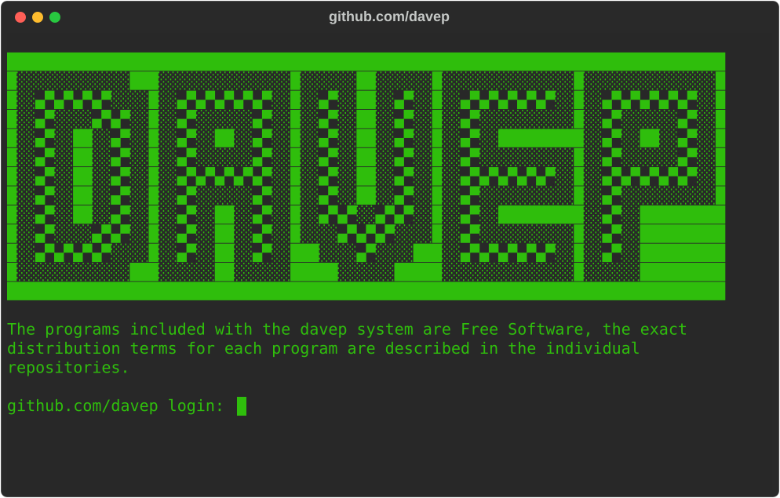

Projects with sites:

[bagofstuff](https://bagofstuff.davep.dev/), [blogmore](https://blogmore.davep.dev/), [complexitty](https://complexitty.davep.dev/), [dhv](https://dhv.davep.dev/), [finger2gemtext](https://finger2gemtext.davep.dev/), [flounder-score](https://flounder-score.davep.dev/), [gemtext](https://gemtext.davep.dev/), [gophermap](https://gophermap.davep.dev/), [grid-bike](https://grid-bike.davep.dev/), [hike](https://hike.davep.dev/), [html2gemtext](https://html2gemtext.davep.dev/), [md2gemtext](https://md2gemtext.davep.dev/), [ng2nlm](https://ng2nlm.davep.dev/), [ng2web](https://ng2web.davep.dev/), [ngdb](https://ngdb.davep.dev/), [ngmcp](https://ngmcp.davep.dev/), [norton-guides](https://norton-guides.davep.dev/), [obs2nlm](https://obs2nlm.davep.dev/), [oldas](https://oldas.davep.dev/), [oldnews](https://oldnews.davep.dev/), [peplum](https://peplum.davep.dev/), [port1900](https://port1900.davep.dev/), [port70](https://port70.davep.dev/), [port79](https://port79.davep.dev/), [rogallo](https://rogallo.davep.dev/), [seen-by](https://seen-by.davep.dev/), [smolserve](https://smolserve.davep.dev/), [sybaritic](https://sybaritic.davep.dev/), [textual-canvas](https://textual-canvas.davep.dev/), [textual-countdown](https://textual-countdown.davep.dev/), [textual-enhanced](https://textual-enhanced.davep.dev/), [textual-fspicker](https://textual-fspicker.davep.dev/), [wasat](https://wasat.davep.dev/)

[//]: # (README.md ends here)
